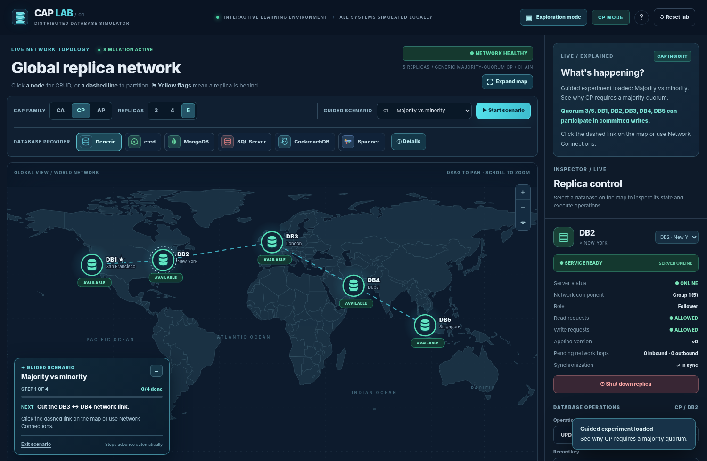
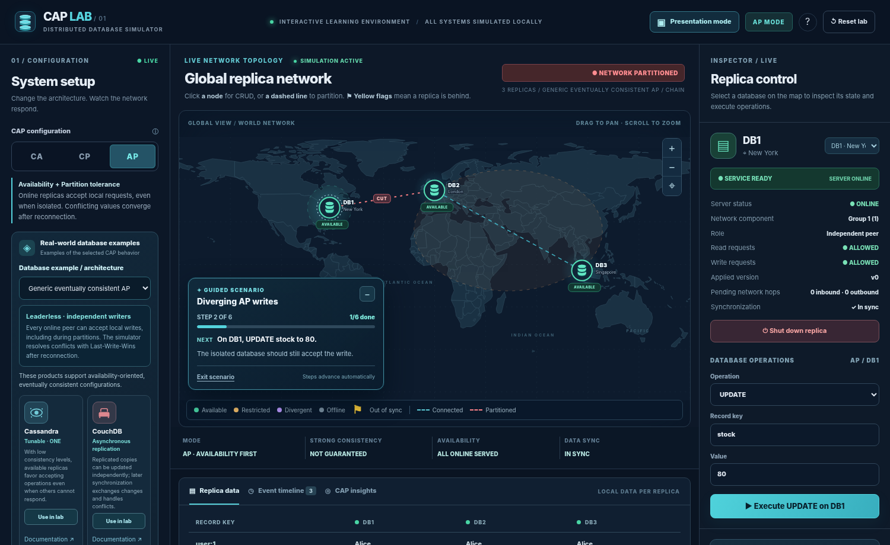

# CAP Lab — Interactive Distributed Database Simulator

**A browser-based virtual laboratory for teaching the CAP theorem, replica failures, leader election, network partitions, and data consistency.**

CAP Lab lets students experiment with a simulated distributed database on an interactive world map. Disconnect a network link, shut down a replica, issue a read or write, and watch the consequences for availability, consistency, and synchronization. No server, account, installation, or API key is required.

> **Educational simulation:** CAP Lab is an intentionally simplified model, not an implementation or benchmark of PostgreSQL, SQL Server, MongoDB, Cassandra, or any other production database. CAP behavior depends on the deployment and its consistency settings, not the product name alone.

## Screenshots

### Presentation Mode — classroom demonstration



The map occupies most of the screen. Instructors can select **CA / CP / AP**, adjust replica count, choose a **database provider profile** using compact icons, and launch guided experiments. The selected replica and the **What's happening?** explanation remain available. A compact instruction panel in the corner of the map walks students through the current scenario.

### Exploration Mode — student experimentation



Exploration Mode shows the full controls: architecture and provider information, network links and connected components, per-replica CRUD operations, simulation speed, comparison of stored data, event timeline, and CAP insights.

## Features

- **Three CAP teaching modes:** CA, CP, and AP, with context-sensitive explanations.
- **3–5 geographic replicas** on a zoomable, pannable world map.
- **Clickable dashed links:** connected links have a subtle flowing animation; click a link to partition or repair the network.
- **Replica shutdown and restart** with visible server and service state.
- **INSERT, UPDATE, DELETE, and READ** against a selected replica.
- **Geographic, multi-hop propagation delays:** replica updates arrive at different times based on network path and simulated distance.
- **Yellow synchronization flags** identify replicas that have not caught up with the current state.
- **CP leader/follower behavior** with a simplified quorum and leader-election model.
- **CA fixed-primary behavior:** the primary serves clients that can reach it while disconnected followers cannot safely serve strong operations; this does **not** guarantee global availability during a partition.
- **AP leaderless replication** with eventually consistent writes and deterministic conflict reconciliation.
- **Database teaching profiles** including PostgreSQL, MySQL, SQL Server, etcd, MongoDB, CockroachDB, Spanner, Cassandra, CouchDB, ScyllaDB, and DynamoDB, as appropriate to the selected mode.
- **Exploration / Presentation views** that preserve active network failures, data, and guided-scenario progress when switched.
- **Five guided scenarios**, each with an on-map instruction panel that advances as students complete the steps.
- **Runs locally or on GitHub Pages** with no build step. The app state is local to each browser session.

## Understanding the interface

| Interface area | Purpose |
| --- | --- |
| **Header** | Displays the application identity, active CAP mode, a view switch, help, and reset. |
| **Configuration sidebar** (Exploration) | Choose CA/CP/AP, replication factor (3–5), architecture/provider profile, guided scenarios, and simulation tools. |
| **World map** | Shows geographic replicas. Click a **database icon** to select a replica; click a **dashed network line** to disconnect or reconnect it. Pan and zoom to inspect the topology. |
| **Node and link indicators** | Green = service available; amber = restricted; gray = offline; purple = divergent; **yellow flag** = replica is behind; cyan moving dashes = link connected; red broken dashes = partitioned. |
| **On-map guided panel** | Shows the active experiment, step number, next instruction, and progress. It can be collapsed. |
| **Replica inspector** (right) | Inspect server role, availability, synchronization status, and stored records; start/stop a replica or perform CRUD operations. |
| **Bottom monitoring tabs** (Exploration) | Compare stored values across replicas, follow the event timeline, and read CAP explanations. |
| **Presentation toolbar** | Compact CAP, replica-count, database-provider, and guided-scenario controls above the enlarged map. |

**Important distinction:** A replica may be *online* yet unable to serve a particular request (for example, a CP replica isolated from the majority). A connected cyan link indicates connectivity; it does not necessarily mean a write is currently transferring. Replication delays are *simulated teaching delays*, not measurements of real-world networks.

## Try your first exercise

1. Open the lab and stay in **Exploration Mode** (or switch to **Presentation Mode**).
2. Choose **CP**, **5 replicas**, and the **Majority vs minority** guided scenario.
3. Cut the connection between **DB3 and DB4** by clicking its dashed line.
4. Observe the two connected groups: **DB1–DB3** (majority) and **DB4–DB5** (minority).
5. Try updating `stock` on DB2, then try a similar operation on DB5.
6. Compare which request can be committed, the quorum explanation, and the nodes' service states.
7. Repair the connection and observe the recovery and synchronization.

For a contrasting activity, use **Diverging AP writes** to create different values for the same key in disconnected partitions and then observe reconciliation when connectivity is restored.

### Included guided scenarios

1. **Majority vs minority** — quorum-based CP requests during a 3/2 split.
2. **Diverging AP writes** — local availability, stale values, conflicts, and convergence.
3. **Leader & node failures** — leader changes and loss of quorum.
4. **The limits of CA** — a fixed primary and the availability cost of partitions.
5. **Compare CP vs AP** — different outcomes under similar failure conditions.

## Run locally

Download or clone this repository and open **`index.html`** in a modern browser. All main application logic, styles, and map drawing are embedded in that file. Provider logos may be loaded from an external CDN when available; local fallback icons are supplied.

No Node.js, database server, API key, or command-line build is needed.

## Publish on GitHub Pages

1. Create a **public** GitHub repository (for example, `cap-lab`).
2. Upload the *contents* of this project into the repository root, preserving `assets/` and its images. Do not upload only the ZIP.
3. Open **Settings → Pages**.
4. Set **Source** to **Deploy from a branch**, choose **`main`**, and select **`/ (root)`**.
5. Click **Save**, and check the Pages/Actions deployment status.
6. Once published, the URL is typically `https://YOUR-USERNAME.github.io/cap-lab/`.

If the website is already published, upload **`README.md`**, **`LICENSE`**, and the **`assets/` screenshots** to update the repository documentation without changing the running simulator.

## Repository structure

```text
cap-lab/
├── index.html                         # Complete browser-based simulation
├── README.md                          # Project guide and screenshots
├── LICENSE                            # MIT license for this project's original code
├── .nojekyll                          # Avoid unnecessary Jekyll processing
└── assets/
    ├── cap-lab-presentation.png       # Actual Presentation Mode screenshot
    └── cap-lab-exploration.png        # Actual Exploration Mode screenshot
```

## Testing and troubleshooting

- Run the built-in simulation checks by appending **`?selftest=1`** to the published URL or by using `CAPLab.runSelfTests()` in the browser developer console. The self-tests reset their local simulation state afterward.
- If GitHub Pages returns **404**, verify that `index.html` is at the repository root and Pages is deploying the correct branch and folder.
- If a README screenshot does not appear, verify the case-sensitive path and that the corresponding file exists inside `assets/`.
- If a provider logo does not load, the lab uses a fallback icon; the simulator can continue functioning offline.
- To restart a teaching exercise, use **Reset lab** or reload the page.

## Educational assumptions and limitations

- **Consistency** means the strong/linearizable consistency guarantee in the CAP theorem, not simply identical cached values or ACID transactions.
- **CA** is a single-primary teaching profile. Its reachable primary may keep working during a partition, but isolated clients and replicas lose availability; CA cannot guarantee both C and CAP availability under arbitrary partitions.
- **CP** uses a simplified majority-quorum, leader-election, and replicated-log model rather than a full implementation of Raft/Paxos or any vendor's specific failover rules.
- **AP** represents a leaderless, eventually consistent design with a chosen deterministic conflict-resolution method. Real products may offer multiple consistency settings and reconciliation strategies.
- **Provider profiles are illustrative**. They are not compatibility tests, vendor certifications, or guarantees about all deployment configurations.
- **No persistent shared backend:** each browser maintains its own transient simulation; reloading resets the exercise and there is no built-in student grading or submission collection.

## License and third-party material

The project's original source code and documentation are released under the **[MIT License](LICENSE)**. The included `LICENSE` uses **“CAP Lab contributors”** as a generic copyright holder; project maintainers should update that line to the appropriate individual or institution when publishing.

Third-party product names, logos, and trademarks belong to their respective owners and are **not** relicensed by MIT. Any externally loaded icon assets are subject to their source licenses. CAP Lab is an independent teaching project and is not endorsed by the database vendors shown.

---

**Made for classroom exploration of distributed databases and the CAP theorem.**
