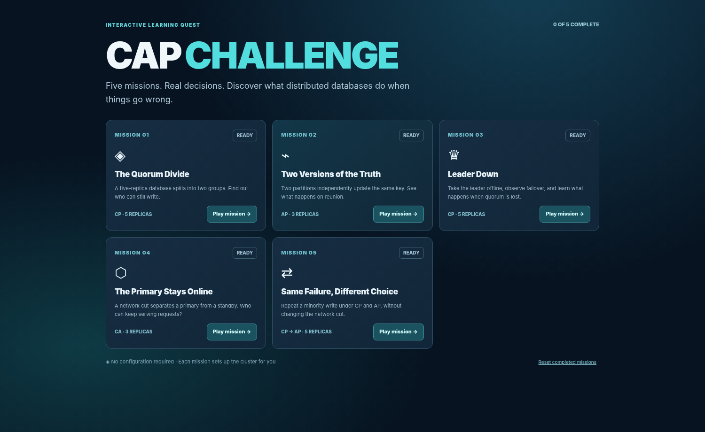
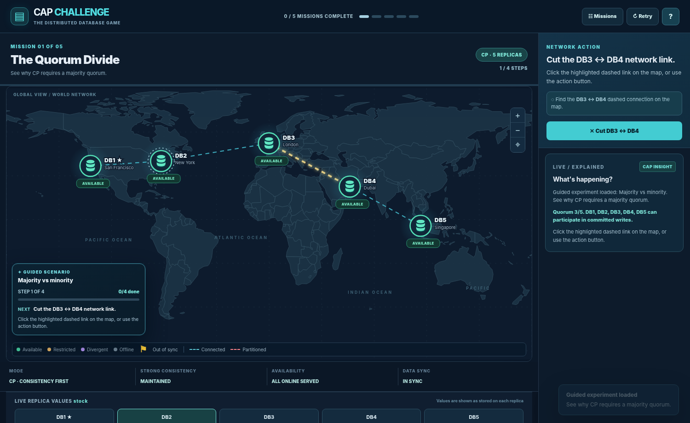
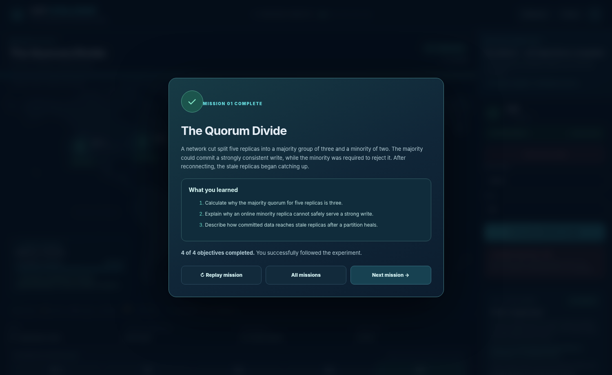

# CAP Challenge — The Distributed Database Game

**Five hands-on missions about the CAP theorem, network partitions, replication, and leader failover.**

CAP Challenge is a companion **student game** to CAP Lab. Each mission automatically configures a simulated cluster. Learners cannot change the number of replicas, CAP policy, or provider settings; they interact only with the operations needed for the current mission. The final CP/AP comparison includes a single, guided policy switch because it is itself the exercise.

## See the game

### Mission selection

### Interactive experiment

### Mission completion and learning outcomes

## How students play

1. Open the game and choose a mission. The CAP policy, replica count, and starting records are set automatically.
2. Follow the current on-map instruction and the highlighted action panel. Students can click the specified network link, select a replica, shut down or restart a node, or execute a preconfigured database operation.
3. Observe responses and changes to individual replica values. **A rejected operation may be the correct result.**
4. When all objectives are met, a completion screen explains what happened and lists **three learning outcomes**.
5. Replay the mission or select **Next mission**. Completion badges are saved *only in the same browser's local storage* when allowed. No student login or account is required.

## The five missions

| Mission | Preset | Challenge | Main learning outcome |
| --- | --- | --- | --- |
| **The Quorum Divide** | 5 replicas, CP | Split the network 3/2; compare majority/minority writes; heal | Strong consistency needs a reachable majority in this teaching model |
| **Two Versions of the Truth** | 3 replicas, AP | Update one key to two different values in disconnected groups; read and reconcile | Available local writes can produce temporary divergence and conflict resolution |
| **Leader Down** | 5 replicas, CP | Fail the leader, then enough followers to lose quorum, and recover | Leader election and continued service depend on enough reachable replicas |
| **The Primary Stays Online** | 3 replicas, CA-style primary/standby | Isolate one standby; test primary and follower operations | A reachable primary can still operate, but isolated clients lose availability |
| **Same Failure, Different Choice** | 5 replicas, CP → AP | Try the same minority write under the two policies | CP rejects a write without quorum; AP accepts a local write |

## Start playing

Download `index.html` and open it in a modern browser. No installation, server, cloud database, account, or API key is needed. All application HTML, CSS, JavaScript, and map rendering data are included in one file.

The game is responsive and can be used in class on a computer, laptop, or tablet. Some interaction areas are easier to use on wider screens.

## Publish with GitHub Pages

**As a standalone repository:**

1. Create a public repository such as `cap-challenge`.
2. Upload `index.html`, `.nojekyll`, `README.md`, `LICENSE` and the `assets/` screenshots into its root.
3. Open **Settings → Pages → Build and deployment**, set **Deploy from a branch**, branch **main**, folder **/ (root)**, and save.
4. Once published, share `https://YOUR-USERNAME.github.io/cap-challenge/` with students.

**As a game alongside an existing CAP Lab repository:** Put `index.html` into the folder **`game/`** in the existing `cap-lab` repository. Its student link will be `https://YOUR-USERNAME.github.io/cap-lab/game/`. An additional ZIP package with the appropriate `game/` folder layout is provided.

GitHub Pages serves static files over HTTPS. Each student runs an independent, in-browser simulation.

## Educational and privacy notes

- This is **a learning simulation**, not an actual PostgreSQL, SQL Server, MongoDB, etc. distributed cluster, or a full implementation of Raft/Paxos.
- Under the **CA single-primary illustration**, the primary may continue serving reachable clients during partitions; disconnected replicas reject strong reads and writes. This does not imply CAP availability for all clients.
- Under **CP**, a simplified majority-quorum leader model governs strong operations.
- Under **AP**, disconnected peers accept local writes and later use deterministic reconciliation. All timings and geographic network delays are pedagogical, not measured network RTTs.
- **Completion badges are local to a browser**, not sent to a server and not a reliable assessment or grade. There is **no automatic teacher dashboard, submission, or identity tracking**.
- Reloading a mission resets its working cluster state; the five completion badges can persist between visits on the same origin and browser, if local storage is permitted.
- The original CAP Lab application remains separate and unchanged.

## Source and license

The game is distributed as a standalone, editable `index.html`, built using the original CAP Lab simulation logic. The MIT license applies to the project's original source and documentation; third-party product names, logos, and map/asset rights remain with their respective holders. Replace the generic copyright-holder line in `LICENSE` with the appropriate owner if needed.
